# Worker 全量类关系图

> 核对范围：2026-11-17 checkout，含编码与历史共享 Agent 实例的调整。
> `app/worker/**/*.py` 的全部 **48 个 AST `ClassDef`**，包括私有类、Protocol、模型、dataclass 和异常。
> 递归核对也包含枚举及嵌套类；当前 worker 内未定义枚举或嵌套类。不含测试替身和包外同名概念。
> 源码链接使用仓库相对路径；文档与源码应一起检出到同一版本。

[打开交互图](worker-classes.html)：直接用浏览器打开，无需构建、联网或安装依赖。
保留下拉定位、点击/键盘选择、一跳关系高亮、侧栏跳转、缩放和适应宽度；可用“导出 SVG”同步静态图。
画布高度最多占视口的 80%，放大后可在画布内横纵滚动；窄屏同步缩放图的最小宽度，页面本身不被撑宽。
图本身可单独离线使用；源码链接使用相对路径，需保留仓库目录结构，行号同时显示在侧栏。
GitHub 文件页不执行 HTML；下方静态 SVG 可直接预览、放大。

## 范围与关系含义

图中共 **64 个节点、125 条关系**：48 个 worker 类、14 个灰色包外边界类、2 个灰色函数锚点。
关系分为 41 条持有/字段、68 条使用、6 条显式继承、10 条结构化 Protocol 满足。
`nodes` / `edges` 的手工定义和布局位于 [HTML](worker-classes.html)。

- **实线箭头**：对象持有引用或模型字段。共享引用不表示独占所有权：每个 Flow 的
  `WorkerExecution.state` 和 `WorkerExecutor.state` 是同一个 `ExecutionState`；所有 Flow 共用目录池和配置后端的 Agent。
  同后端编码与历史查询共用一个 Agent；推理因输出预算更小保留独立实例。
- **虚线箭头**：创建、临时参数、函数/静态方法调用、持久模型读写或异常抛出/捕获。
  侧栏逐条注明；间接调用会标出中间函数或 Runtime，避免把 import 画成持有关系。
- **实线空心三角**：显式 Python 继承，指向基类。worker 内有
  `FlowToolCallError → WorkerProtocolError`、`RepositoryProvisionError → VcsVerificationError`、
  `ExecutionRecord / _LegacyRecord → _RecordFields`；另外两条指向包外 `ProtocolModel`。
  其余标准库/第三方基类写在节点内，不再展开。
- **虚线空心三角**：结构化满足 Protocol，未显式继承。包括 `WorkerExecutor → TaskExecutor`、
  `WorkerExecution → FlowToolCaller`、两个原生 Agent → worker 内 `CodingAgent`、
  `WebSocketTransport → Transport`、四组连接回调 → `SessionCallbacks`、`NativeAgentInference → Inference`。
- 灰色类来自 `app/communication`、`app/inference`、`app/domain` 或 `app/contracts`，不计入 48 类。
  `link_history()`、`update_worker()` 是函数锚点；`AmpCodingAgent.run_process()` 是方法，不另造节点。
- 两个私有 `_OutputLimit` 各占一个节点，ID 为 `codex._OutputLimit` / `amp._OutputLimit`，
  展示名均保留真实类名；文件路径区分其身份。继承字段只在定义类上连线，不为每个子类重复画边。

依据：[Runtime 装配](../../app/worker/runtime.py#L149-L210)、
[执行所有权与工具 Future](../../app/worker/execution/lifecycle.py#L69-L101)、
[Executor 注入](../../app/worker/execution/executor.py#L59-L95)、
[worker-local CodingAgent](../../app/worker/coding_agent.py#L10-L29)。

## 全量类清单

链接逐个定位 `class` 所在行，按模块列出完整集合；数量以 AST 集合相等为准。

| 模块 | 全部类（定义行） | 数量 | 当前职责 |
| --- | --- | ---: | --- |
| `coding_agent.py` | [CodingAgent:10](../../app/worker/coding_agent.py#L10) | 1 | worker 内 start / resume / read_history 结构化接口 |
| `config.py` | [WorkerSettings:12](../../app/worker/config.py#L12) | 1 | 配置、trusted-host 隔离与 WS 安全约束 |
| `runtime.py` | [Connection:69](../../app/worker/runtime.py#L69)、[WebSocketTransport:75](../../app/worker/runtime.py#L75)、[WorkerRootLock:108](../../app/worker/runtime.py#L108)、[WorkerRuntime:149](../../app/worker/runtime.py#L149) | 4 | IO 适配、root 锁、多 Flow 装配、连接替换与历史路由 |
| `health.py` | [HealthFile:12](../../app/worker/health.py#L12) | 1 | 本地连接状态文件；不证明执行所有权 |
| `transport/state.py` | [WorkerStateCallbacks:90](../../app/worker/transport/state.py#L90) | 1 | 注册、库存、恢复、结果/停止握手、心跳与协议授权 |
| `transport/business.py` | [WorkerBusinessCallbacks:29](../../app/worker/transport/business.py#L29) | 1 | 独立历史查询；借用执行拥有的工具调用并关联回复 |
| `transport/files.py` | [WorkerFileCallbacks:21](../../app/worker/transport/files.py#L21) | 1 | 有界异步文件读取和同一串行 driver 内的回复 |
| `transport/mcp.py` | [FlowToolCaller:25](../../app/worker/transport/mcp.py#L25)、[_EmbeddedServer:32](../../app/worker/transport/mcp.py#L32)、[WorkerMCP:39](../../app/worker/transport/mcp.py#L39) | 3 | INITIAL 与修正共享的 MCP、VCS 前置核验、执行工具回调 |
| `execution/lifecycle.py` | [TaskExecutor:37](../../app/worker/execution/lifecycle.py#L37)、[WorkerProtocolError:48](../../app/worker/execution/lifecycle.py#L48)、[FlowToolCallError:52](../../app/worker/execution/lifecycle.py#L52)、[PendingToolCall:69](../../app/worker/execution/lifecycle.py#L69)、[WorkerExecution:76](../../app/worker/execution/lifecycle.py#L76) | 5 | 每 Flow 的 Task、工具 Future、取消/join、停止凭据和结果重放 |
| `execution/executor.py` | [WorkerExecutor:59](../../app/worker/execution/executor.py#L59) | 1 | 三类任务编排、Schema/VCS 核验、修正、修订 fallback 与归档清理 |
| `execution/codex.py` | [_OutputLimit:42](../../app/worker/execution/codex.py#L42)、[CodexAgent:119](../../app/worker/execution/codex.py#L119)、[CodexHistory:304](../../app/worker/execution/codex.py#L304) | 3 | Codex 执行监督与自有原生 JSONL 历史读取 |
| `execution/amp_agent.py` | [AmpProcessResult:108](../../app/worker/execution/amp_agent.py#L108)、[_OutputLimit:116](../../app/worker/execution/amp_agent.py#L116)、[AmpCodingAgent:235](../../app/worker/execution/amp_agent.py#L235)、[_Snapshot:424](../../app/worker/execution/amp_agent.py#L424)、[AmpHistory:430](../../app/worker/execution/amp_agent.py#L430) | 5 | Amp 执行与有界进程监督；自有 export 历史、脱敏、短时缓存与分页 |
| `execution/inference.py` | [NativeAgentInference:31](../../app/worker/execution/inference.py#L31) | 1 | 无仓库目录、仅 start 的独立回答会话与输出预算 |
| `execution/vcs.py` | [VcsVerificationError:27](../../app/worker/execution/vcs.py#L27) | 1 | VCS/目录核验函数的分阶段错误 |
| `execution/workspaces.py` | [RepositoryProvisionError:37](../../app/worker/execution/workspaces.py#L37)、[WorkspaceBinding:45](../../app/worker/execution/workspaces.py#L45)、[WorkspaceSlot:55](../../app/worker/execution/workspaces.py#L55)、[InferenceWorkspace:81](../../app/worker/execution/workspaces.py#L81)、[WorkspaceManifest:87](../../app/worker/execution/workspaces.py#L87)、[_LegacySlot:96](../../app/worker/execution/workspaces.py#L96)、[_LegacyManifest:104](../../app/worker/execution/workspaces.py#L104)、[RepositoryWorkspaces:123](../../app/worker/execution/workspaces.py#L123) | 8 | manifest v3、实际目录库存与 generation fence、默认推理位置、旧格式兼容 |
| `state/execution.py` | [ExecutionStateError:34](../../app/worker/state/execution.py#L34)、[ExecutionState:38](../../app/worker/state/execution.py#L38) | 2 | 每 Flow journal、迁移、恢复/停止/清理证据与 ACK；不读历史 |
| `state/record.py` | [JournalSelection:29](../../app/worker/state/record.py#L29)、[_RecordFields:35](../../app/worker/state/record.py#L35)、[ExecutionRecord:99](../../app/worker/state/record.py#L99)、[_LegacyRecord:105](../../app/worker/state/record.py#L105) | 4 | journal v5 schema、只读 v4 转换及旧选择记录校验；不拥有 IO |
| `state/file_links.py` | [LocalFile:17](../../app/worker/state/file_links.py#L17)、[FileLinks:46](../../app/worker/state/file_links.py#L46) | 2 | 持久文件 ID、本地 inode/device 身份或 Amp URL、按需读取 |
| `state/amp_attachments.py` | [AmpAttachment:16](../../app/worker/state/amp_attachments.py#L16) | 1 | 允许的私有附件 URL；原生身份认证与受限下载 |
| `self_update.py` | [UpdateError:34](../../app/worker/self_update.py#L34)、[InstalledPackage:39](../../app/worker/self_update.py#L39) | 2 | 独立更新分支的已安装事实与安全失败 |
| **合计** | | **48** | |

## 当前的主要关系路径

### 执行所有权跨重连，回调按连接替换

`WorkerRuntime.executions[flow_id] → WorkerExecution → TaskExecutor(WorkerExecutor)`。
执行对象持有工具队列和原调用者 Future；MCP 经 `FlowToolCaller(WorkerExecution)` 提交工具调用。
`WorkerBusinessCallbacks.pending` 只借用同一调用，注册回复关联，不接管执行 Task/Future。
Runtime 创建一个共享 `RepositoryWorkspaces`，为每个 Flow 创建一份 `ExecutionState` 并同时注入执行对象和 Executor。
Executor 的 `code_agent` 来自 Runtime 的共享后端实例；会话、cwd、临时凭据和子进程保持为每次调用的局部状态。
见 [Runtime](../../app/worker/runtime.py#L200-L210)、[工具队列](../../app/worker/execution/lifecycle.py#L284-L370)、
[借用与回复](../../app/worker/transport/business.py#L90-L172)。

每条连接通过 `WebSocketTransport → Transport` 进入共享 `Session`，`Gateway.serve()` 创建 `Dispatcher`，
挂载 state / business / inference / file 四组回调并串行处理事件。state 和 business 回调持有 Runtime 的反向引用，
所以静态图中存在真实的连接期引用环；Runtime 只在 `_serve_connection()` 内临时使用这些回调，按连接关闭它们。
`WorkerInferenceCallbacks` 属于包外共享实现，持有当前连接的推理 Task，断线时需要取消并等待其清理。
见 [连接装配与关闭](../../app/worker/runtime.py#L348-L391)、
[共享 driver](../../app/communication/gateway.py#L39-L105)、[推理回调](../../app/inference/transport.py#L29)。

### 编码与历史共用 Agent，历史仍跟随请求 session

`WorkerBusinessCallbacks → WorkerRuntime.read_history() → _agents[prefix] → CodingAgent.read_history()`。
Runtime 的 `_agents` 为 Codex、Amp 各持有一个实例；所有 Executor 按配置后端复用其中同一对象，不为每个 Flow 再创建 Agent。
历史查询复用这个集合，`T-` 前缀选择 Amp，其余选择 Codex，不依赖当前配置的后端或活动 Flow。
每个 Agent 自己创建 History，历史读取不要求 trusted-host 编码授权；同步 reader 被卸载到线程，保留各自限流和缓存。
`ExecutionState` 只负责执行持久证据，无 History 引用或历史入口。
编码与历史相关 Agent 固定为两个，不随 Flow 数量增长；推理仍另用一个小输出预算实例。
见 [共享后端与推理装配](../../app/worker/runtime.py#L165-L181)、[Executor 注入](../../app/worker/runtime.py#L200-L210)、
[读取与超时](../../app/worker/runtime.py#L255-L264)、
[Codex Agent](../../app/worker/execution/codex.py#L119-L131)、[Amp Agent](../../app/worker/execution/amp_agent.py#L235-L247)。

Amp 的编码、历史导出和附件下载共用静态 `AmpCodingAgent.run_process()`；`AmpHistory → AmpCodingAgent`
是方法调用边，`AmpCodingAgent → AmpHistory` 是实例持有边，二者不表示循环构造。
流式 init/final 校验在 `_outcome()` 内进行，已无 `_Init` / `_Result` 模型。
见 [进程监督](../../app/worker/execution/amp_agent.py#L249-L352)、
[流式结果解析](../../app/worker/execution/amp_agent.py#L165-L232)、
[历史 export](../../app/worker/execution/amp_agent.py#L456-L497)、
[附件下载](../../app/worker/state/amp_attachments.py#L42-L69)。

### 文件出站投影与独立推理

原生 History 返回 `HistoryPage` 后，Runtime 调用 `link_history(page, self.register_file, ...)`，
深拷贝缓存页、识别实际 Markdown 目标并登记文件，只改写出站副本。
`FileLinks` 在磁盘记录 `LocalFile | AmpAttachment` 身份，读取时重新核验本地文件身份，或临时下载远端附件；
`WorkerFileCallbacks` 负责有界读取与发送。见 [链接投影](../../app/worker/state/history_links.py#L171)、
[登记与读取](../../app/worker/state/file_links.py#L46-L97)、[文件回调](../../app/worker/transport/files.py#L21-L70)。

Runtime 的 `NativeAgentInference` 持有独立 Agent，在目录池提供的无仓库目录里运行新会话，
保留比编码更小的输出预算，仅调用 `start(context=None)`，验证 `InferenceTask → InferenceOutput`，不续用编码 session。
见 [推理装配](../../app/worker/runtime.py#L173-L193)、[推理适配](../../app/worker/execution/inference.py#L31-L115)。

## 类图之外的函数与共享模型

### 无类模块与函数所有权

| 模块 / 函数 | 调用方及职责 |
| --- | --- |
| [cli.py](../../app/worker/cli.py) | 普通启动持有安装共享锁后运行 Runtime；`--update` 调用更新函数后退出 |
| [execution/prompts.py](../../app/worker/execution/prompts.py) | INITIAL、修正和 REVISION 的提示词构造 |
| [execution/credentials.py](../../app/worker/execution/credentials.py) | Agent / VCS 复用可信宿主环境过滤和临时 Git credential 环境 |
| [execution/gh.py](../../app/worker/execution/gh.py) | gh 可用性核验与本轮 bot gh 包装；不引入长期 GitHub client |
| [execution/git_identity.py](../../app/worker/execution/git_identity.py) | 目录池配置当前能力所对应的 Git 作者身份 |
| [execution/idle.py](../../app/worker/execution/idle.py) | 两个原生 Agent 的无新输出超时等待；进程回收由 Agent 负责 |
| [execution/vcs.py](../../app/worker/execution/vcs.py) | 执行前后及 MCP 转发前核验；目录池复用 seed、clean、align、worktree 核验函数 |
| [state/files.py](../../app/worker/state/files.py) | journal、manifest、文件身份记录共用的私有原子写入与目录 fsync |
| [state/history_links.py](../../app/worker/state/history_links.py#L171) | `link_history()` 函数锚点；Markdown 解析及文件注册回调，未造额外服务类 |
| [self_update.py](../../app/worker/self_update.py#L233) | `update_worker()` 函数锚点；安装独占锁、来源核验、更新与新进程验证 |

各级 `__init__.py` 不定义类。`health.py` 另有 `healthy()` / `main()` 探针入口。
`execution/amp_process.py`、`state/history.py`、`state/amp_history.py` 已删除；它们原有职责由具体 Agent 模块承接。

### 包外边界

14 个灰色类展示关键接口和数据流，其余共享模型在这里说明；不重复展开整个领域层或消息继承树。

| 来源 | 已画节点 / 补充边界 |
| --- | --- |
| [communication/](../../app/communication/) | 已画 `Gateway`、`Session`、`Dispatcher`、`Transport`、`SessionCallbacks`；Gateway 经 `Registration` 持有 Session 和路由器，省略中间类节点 |
| [inference/transport.py](../../app/inference/transport.py#L29) | 已画共享 `WorkerInferenceCallbacks`，包外身份与 worker 自定义回调明确区分 |
| [domain/ports.py](../../app/domain/ports.py#L18) | 已画 `Inference`；`CodingAgent` 已迁入 worker 包，不再属于该模块 |
| [domain/inference_models.py](../../app/domain/inference_models.py) | 已画 `InferenceTask`、`InferenceOutput`；另消费 capability、failure 与异常 |
| [domain/models.py](../../app/domain/models.py#L334-L393) | 已画 `CodingExecutionContext`、`CodingExecutionResult`；前者携带可空 `GitHubCapability` 和 MCP 能力，VCS 使用 `VcsExecutionContext` / `VcsOutcome` / `VcsKind`，Codex 可抛出 `SessionUnavailable` |
| [domain/models.py 的输出契约](../../app/domain/models.py#L446-L462) | Executor 解析 `InitialCodingOutput` / `RevisionCodingOutput` 并独立核验业务结果 |
| [contracts/protocol.py](../../app/contracts/protocol.py) | 已画 `ProtocolModel`；`Assignment.arguments` 中包含 `AssignmentArguments → InitialTask / RevisionTask / ArchiveTask`，临时 secret 不进入 journal；另有恢复/停止/工具/文件/推理与注册库存消息 |
| [contracts/conversation.py](../../app/contracts/conversation.py) | 已画 `HistoryQuery`、`HistoryPage`；页内含 `HistoryItem → ConversationContent`，失败使用 `ConversationFailure` |
| [contracts/files.py](../../app/contracts/files.py) | `FileFailure`、文件 ID 与字节上限；文件路径和原生远端认证留在 worker |
| [contracts/receipts.py](../../app/contracts/receipts.py) | `_LegacyRecord` 读取旧 `LegacyTerminal` / `LegacyStopped` 并显式投影成当前业务凭据 |
| [domain/delivery_models.py](../../app/domain/delivery_models.py) | `DeliveryReceipt` 贯穿 MCP 返回、`PendingToolCall.future` 与 INITIAL 交付核验 |

## 历史沿革与保留边界

同一口径递归统计 `app/worker/**/*.py` 的 AST `ClassDef`：

| 版本 | Worker 类数量 | 变化 |
| --- | ---: | --- |
| [最初类图](https://github.com/b1indsight/agentflow/commit/8fa8fa3193c865a31cecb38c7dcaa38994d39d37) | 33 | 旧代码基线 |
| [合入 main](https://github.com/b1indsight/agentflow/commit/f6eb85c369cc054e4c41a75166514bb03dfe0dac) | 49 | 多 Flow 执行、共享通信、文件、推理和兼容模型等变更 |
| [Agent 职责收拢](https://github.com/b1indsight/agentflow/commit/6a1fa5cb188ca75b8bd5cd9adcbec8d620764726) | 48 | 删除 `_Init` / `_Result`，原包外 `CodingAgent` 移入统计范围 |
| 当前实例共享调整 | 48 | 只改变对象装配，不新增或删除类 |

图中的 64 个节点包含 14 个包外类和 2 个函数，不等于 Worker 类数量。
执行生命周期拆分见 [`bbf8504`](https://github.com/b1indsight/agentflow/commit/bbf85048c432bf3d0e2960d36adde758eaeba9ea)，
共享 Session / callbacks 与 `transport/client.py` 移除见
[`4d9f37e`](https://github.com/b1indsight/agentflow/commit/4d9f37edf74726c89bda073d3a8c60674fbc5bec)，
并发目录库存见 [`fadf3c1`](https://github.com/b1indsight/agentflow/commit/fadf3c1fe1d77d1c96b22cf259e385710fc50bbd)。
本轮图对齐 worker-local Agent 接口、编码与历史共享后端实例、Agent 自有 History 与静态 Amp 进程监督。

简化后仍需按实际生命周期读图：执行对象跨重连存活；连接回调只借用编码执行；历史 reader 不依赖 journal；
journal 和目录 manifest 分别证明执行状态和目录身份；文件 ID 独立于当前 assignment。
其中 generation 与目录身份核验见 [WorkspaceBinding](../../app/worker/execution/workspaces.py#L45-L78)、
[claim / release](../../app/worker/execution/workspaces.py#L364-L465)，
终态/清理 ACK 见 [ExecutionState](../../app/worker/state/execution.py#L402-L451)。

## 维护、精确核对与渲染

1. 手工维护 HTML 的 `nodes` / `edges` / `groups`，以源码构造、字段、类型注解和调用为依据。
   `id` 必须全局唯一；真实类名是 `node.name || node.id`。嵌套类新增时采用限定 ID，仍保留其真实类名和定义行。
   标题避让同时覆盖分组标题栏及实际 `getBBox()` 文字区域，并为描边和关系线预留 10 个 SVG 单位。
   Agent 分组使用短标题；`coding_agent.py`、`execution/codex.py`、`execution/amp_agent.py` 保留在图下说明及类清单中。
2. 递归解析所有 worker `.py` 的 AST，用 `ast.walk()` 收集每一个 `ClassDef`，
   与排除 `kind=external/function` 后的图节点逐项比较 `(文件, 类名, lineno)` 的有序多重集。
   同时核对限定身份、唯一 ID 和清单表，不允许只比较总数；当前核对结果为 **48 对 48，缺失/多余/行号差异均为 0**。
   灰色类与两个函数锚点的定义行也须核对，所有边端点须存在。
3. 本文和 HTML 使用同目录源码相对链接与实际行号，应与源码一起检出和更新。
   若改用 GitHub 固定链接，须等包含对应源码的提交产生后，再一起更新核对基线和静态图。
4. 用浏览器打开 `docs/architecture/worker-classes.html`，点击 **“导出 SVG”**，用下载结果覆盖同目录
   `worker-classes.svg`。导出直接复用 `serializeGraph()`：嵌入图形 CSS，移除聚焦/淡化和缩放状态，
   保留全部节点、关系、标题和图例；输出 **2140 × 2180**，无需 Graphviz、构建或网络。
5. 也可由现有 Playwright 环境打开本地 HTML，用 `page.evaluate(() => serializeGraph())` 获取 SVG。
   核对静态与交互图的节点/边一致，检查文本边界、箭头、下拉定位、Enter/Space、关系侧栏、reset、zoom/fit 和导出。

本次图形检查覆盖：全部 64 个节点的选择与源码链接、125 条边的有效端点/唯一性、所有节点和标题的文字边界、
键盘与鼠标/侧栏跳转、重置与缩放、聚焦前后导出一致，以及独立 SVG 的 XML 解析和节点/边数量。
桌面默认、Amp 聚焦及窄屏默认/放大截图均已检查：关系线不遮挡标题，图在画布内横向滚动、
整页纵向浏览，页面无横向溢出；窄屏放大确实增加图宽，打印时解除缩放限制。
类图检查不证明真实 GitHub、Codex 或 Amp 链路已验收。
